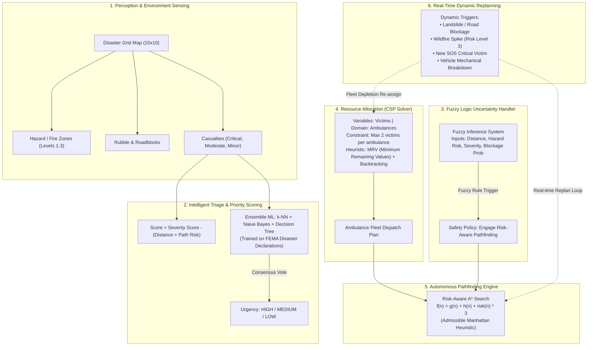

# AIDRA: Adaptive Intelligent Disaster Response Agent
> **An Intelligent Hybrid Disaster Rescue & Autonomous Emergency Dispatch Platform**  
> *Developed for Academic Demonstration & Advanced Applications of Artificial Intelligence*

[](https://python.org)
[](https://flask.palletsprojects.com/)
[](https://scikit-learn.org/)
[](DisasterDeclarationsSummaries.csv)
[](#)

---

## 🌟 Executive Summary

During natural disasters (flash floods, earthquakes, wildland firestorms), emergency response teams confront high chaos, rapid environmental degradation, limited ambulance resources, and blocked transportation corridors. Traditional dispatching relies heavily on slow, error-prone manual coordination.

**AIDRA** is an autonomous hybrid AI decision support system designed to bridge this critical gap. Rather than relying on a single isolated algorithm, AIDRA integrates **five foundational pillars of Artificial Intelligence** into a cohesive, closed-loop sense-plan-act architecture:

1. **Intelligent Multi-Factor Victim Prioritization** (Medical urgency vs. distance and hazard exposure)
2. **Optimal & Risk-Aware Search Algorithms** (A*, Risk-Aware A*, BFS, DFS, Greedy Best-First, Hill Climbing)
3. **Constraint Satisfaction Problem (CSP)** (Resource-constrained ambulance allocation using MRV heuristics and backtracking)
4. **Machine Learning Ensemble Classification** (k-NN, Gaussian Naive Bayes, Decision Tree trained on real FEMA disaster data)
5. **Fuzzy Logic Decision-Making** (Handling environmental uncertainty and road blockage likelihood)
6. **Real-Time Dynamic Replanning** (Real-time adaptation to blocked corridors, risk spikes, new casualties, and ambulance failure)

---

## 🏗️ System Architecture



---

## 🧠 Planning and dispatch algorithms

### 1. Search & Pathfinding Algorithms
The platform provides a side-by-side comparative laboratory of 6 classic search strategies:

| Algorithm | Category | Step Count | Risk Incurred | Optimality | Evaluator Takeaway |
| :--- | :--- | :---: | :---: | :--- | :--- |
| **Risk-Aware A\*** | Heuristic / Informed | **Balanced** | **Hazard-penalized** | **Optimal for weighted cost** | **Recommended for disaster zones:** Minimizes travel plus a hazard penalty with $f(n) = g(n) + h(n) + \text{risk} \times 3$. It prefers safer routes but cannot guarantee zero risk. |
| **Standard A\*** | Heuristic / Informed | **Minimal** | **High** | **Mathematically Optimal** | Minimizes distance using $f(n) = g(n) + h(n)$. Guarantees shortest path, but walks straight through active firezones if unblocked. |
| **Breadth-First Search (BFS)** | Blind / Uninformed | **Minimal** | **High** | **Optimal Steps** | Uniform queue expansion. Guarantees shortest step count in unweighted graphs, but evaluates hundreds of unnecessary states and ignores danger. |
| **Depth-First Search (DFS)** | Blind / Uninformed | **Excessive (20+)** | **Extreme** | **Non-Optimal** | Deep LIFO dive. Produces wild, dangerous zigzags across the map. Inadmissible for emergency transport. |
| **Greedy Best-First** | Heuristic / Informed | **Fast** | **Moderate** | **Approximate** | Only evaluates heuristic distance $h(n)$. Extremely fast, but easily trapped near concave obstacles. |
| **Hill Climbing** | Local Search | **Fast** | **Variable** | **Local Optima Risk** | Moves only to neighbors with strictly better heuristic. Prone to getting stuck when encountering hazard clusters. |

The live dashboard compares each algorithm's route to the currently selected victim using **weighted route cost = steps + 3 × risk points** (lower is better). It shows the measured cost and percentage difference from Risk-Aware A*. This is a route-quality comparison, not a benchmark of computation time; ties are expected when routes have the same distance and risk.

### 2. Multi-ambulance rescue dispatch
- Choose **1–6 ambulances** in the dashboard.
- Each ambulance is assigned the highest-priority reachable victim using severity, round-trip distance, and route risk.
- Every trip carries one victim to a reachable hospital. The ambulance's next trip starts at that hospital, so a single ambulance can continue rescuing victims until none remain reachable.
- Multiple ambulances share the remaining rescue queue. Victims that cannot reach a hospital safely remain marked as waiting.

### 3. Machine Learning Decision Support (Trained on Real FEMA Data)
- **Dataset:** Historical FEMA declarations ([`DisasterDeclarationsSummaries.csv`](DisasterDeclarationsSummaries.csv)).
- **Engineered Features:** 
  1. `distance`: Estimated travel distance to casualty.
  2. `risk`: Incident severity index (Fire=3, Hurricane=3, Flood=3, Severe Storm=2, etc.).
  3. `severity`: Injury classification (Critical=3, Moderate=2, Minor=1).
- **Supervised Classifiers:**
  - **k-Nearest Neighbors (k-NN):** Instance-based distance metric.
  - **Gaussian Naive Bayes (NB):** Probabilistic conditional likelihood.
  - **Decision Tree (DT):** Explainable threshold rules.
- **Ensemble Majority Voting:** `Final_Priority = Mode(k-NN, Naive_Bayes, Decision_Tree)`. Protects against single-classifier outlier predictions.

### 4. Fuzzy Logic for Environmental Uncertainty
Real-world disaster corridors are rarely binary. AIDRA utilizes continuous fuzzy membership functions:
- **Distance:** `Near` ($\le 6$), `Medium` ($6-12$), `Far` ($> 12$).
- **Risk:** `Low` ($\le 2$), `Medium` ($2-5$), `High` ($> 5$).
- **Blockage Probability:** `Unlikely` ($< 30\%$), `Possible` ($30-70\%$), `Likely` ($> 70\%$).
- **Inference Rule Example:**
  $$\text{IF Severity is Critical AND Blockage is Possible} \longrightarrow \text{Decision is HIGH Urgency}$$
- **Impact on Planner:** Fuzzy output is shown as decision support. Rescue trips use Risk-Aware A* to account for hazard costs.

### 5. Mathematical Victim Prioritization
The autonomous agent ranks all victims dynamically using:
$$\text{Priority Score} = \text{Severity Base Score} - (\text{Distance} + \text{Path Risk})$$
Where:
- `Critical` = $100\text{ pts}$
- `Moderate` = $50\text{ pts}$
- `Minor` = $10\text{ pts}$

*Example:* Victim $V_1$ (Critical, Dist=5, Risk=0) scores $100 - (5+0) = 95$. Victim $V_3$ (Moderate, Dist=10, Risk=2) scores $50 - (10+2) = 38$. $V_1$ is unambiguously selected for immediate dispatch.

---

## 🎮 Interactive Web Command Center Features

1. **Live Emergency Command Center:**
   - Mission overview cards show reported and rescued victims, available ambulances, and total trip distance.
   - Configure the fleet size and animate every trip, including hospital-to-victim follow-up dispatches.
   - Victims remain visible on the map until the ambulance reaches them, then their markers disappear; their status changes from picked up to delivered at the hospital.
   - Map endpoints use consistent labels across the overview and scenario editor: `BASE`, `H1`, `H2`, etc. for hospitals, and `V1`, `V2`, etc. for victims. Victim colors consistently indicate severity.
   - An in-app notification announces each rescued victim by ID; the activity log retains the full rescue history.
   - Interactive Cell Inspector: hover over any cell to inspect coordinates, terrain, and risk level.
2. **Algorithm Switcher on Map:**
   - Buttons directly above the grid allow instant one-click route previews of A*, Risk-Aware A*, BFS, DFS, Greedy, and Hill Climbing, with a measured weighted-cost comparison for the selected victim.
3. **Instant Dynamic Scenario Buttons (For Live Demonstrations):**
   - 🚧 **Block Road:** Simulates road collapse along the active route $\to$ agent instantly recalculates alternate corridor.
   - 🔥 **Risk Spike:** Increases fire hazard to Level 3 $\to$ agent switches to Risk-Aware detour.
   - 🚨 **New SOS Victim:** Spawns new casualty $\to$ agent dynamically re-scores and re-prioritizes.
   - 🚑 **Fleet Loss:** Removes one ambulance and replans the remaining rescue queue.
4. **Planning and analysis pages:**
   - Shared navigation labels and the same light color palette are used across every page.
   - `/search-trace` (Route algorithms): Step-by-step route comparison.
   - `/csp-solver` (Fleet planning): Ambulance allocation and backtracking trace.
   - `/ml-studio`: Classifier metrics and interactive prediction playground.
   - `/analytics`: Visual Chart.js comparison charts for route length and danger exposure.
   - `/simulation` (Simulation log): Full console output trace.

---

## 🚀 Quick Start Guide

### 1. Prerequisites
- Python 3.10, 3.11, 3.12, or 3.13
- Git

### 2. Installation
```bash
# Clone the repository
git clone https://github.com/SanaAli17/AI-Disaster-Rescue-System.git
cd AI-Disaster-Rescue-System

# Install required dependencies
pip install -r requirements.txt
```

### 3. Launching the Platform

#### Option A: Web Command Center
```bash
python app.py
```
Open your browser to: **`http://127.0.0.1:5000`**

#### Option B: Standalone Terminal Simulation
```bash
python main.py
```

---


*Developed as an intelligent hybrid system demonstrating Search, Constraint Satisfaction, Supervised Machine Learning, Fuzzy Logic, and Dynamic Replanning for emergency response applications.*
